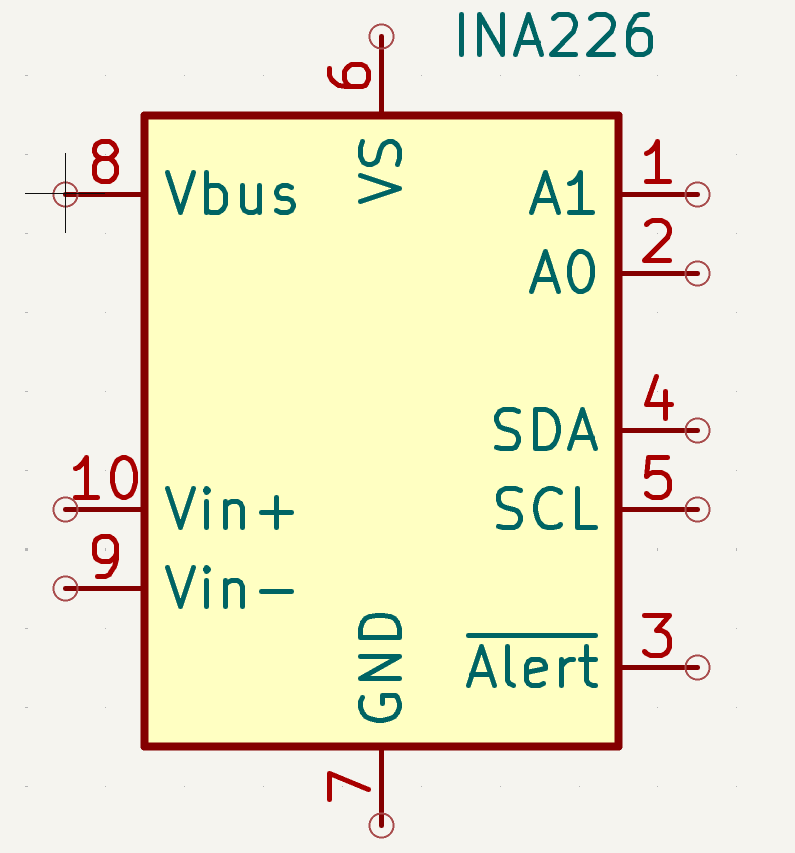
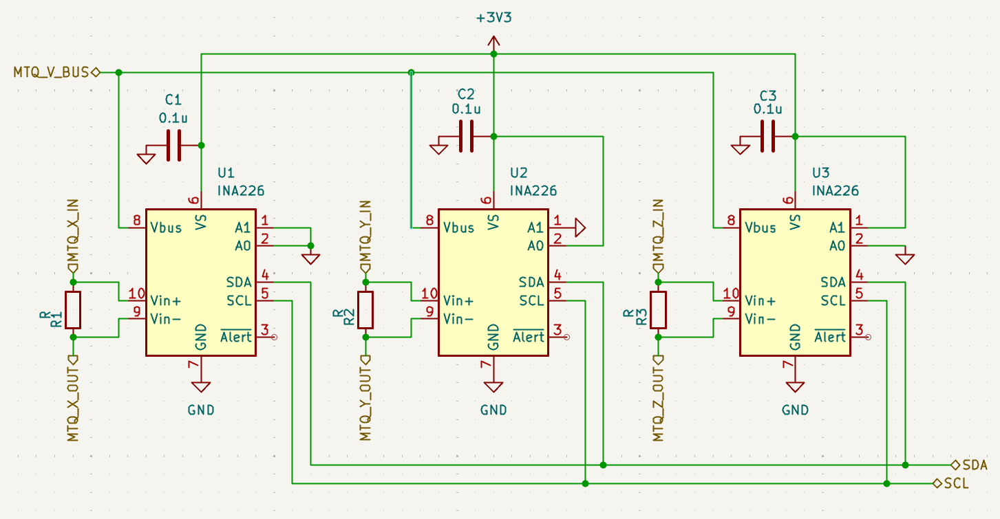
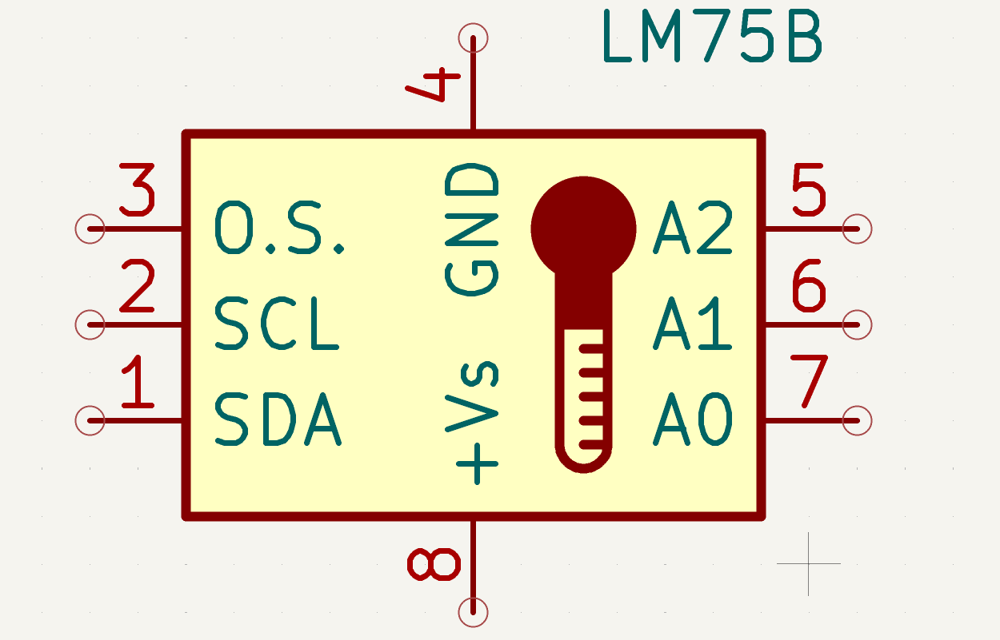
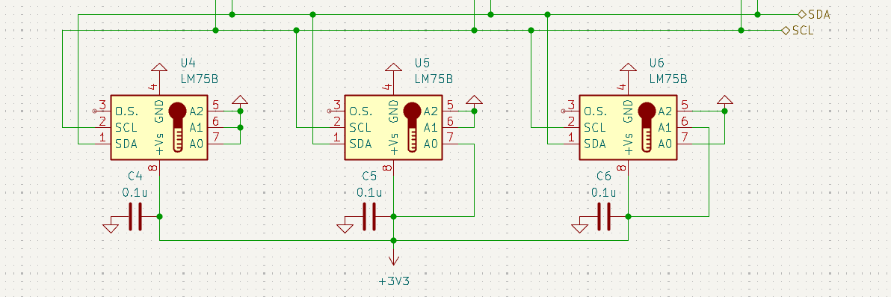
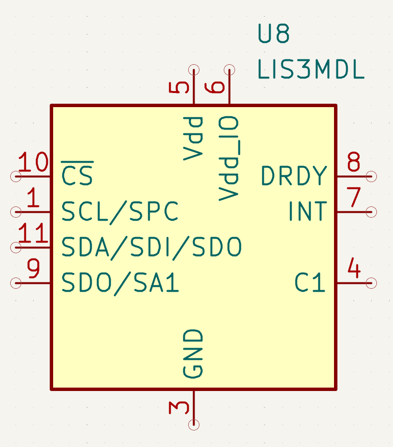
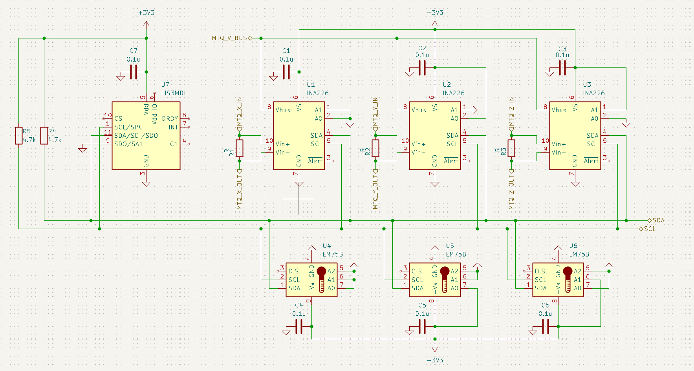

<link rel="stylesheet" href="https://cdn.jsdelivr.net/npm/katex@0.16.9/dist/katex.min.css">

<h1>Sensing and Telemetry Page</h1>

Harware Schematic Page 6 for ADCS Satalite. 

<strong>Specifications</strong>

<table align="center"><colgroup><col width="23.20%"><col width="29.72%"><col width="20.08%"><col width="27.00%"></colgroup><tbody><tr><td><strong>Section</strong></td><td><strong>Specification</strong></td><td><strong>Role</strong></td><td><strong>Testing</strong></td></tr><tr><td>Coil Current Telemetry [Section 1]</td><td>The board shall measure the instantaneous current through each of the three magnetorquer channels using dedicated current-sense amplifiers.</td><td>Verifies torque actuation, calculates true dipole moment, and detects open/short coil faults.</td><td>Test / Calibration</td></tr><tr><td>Rail Voltage Telemetry [Section 1]</td><td>The board shall monitor the 3.3V logic and 5.0V actuator rails using MCU ADC divider networks. [CURRENT IMPLEMENTATION USES DIFFERENT APPROACH]</td><td>Critical bus health monitoring.</td><td>Test</td></tr><tr><td>Actuator Thermal Monitoring [Section 2]</td><td>The board shall feature at least one digital temperature sensor (e.g., TMP100 / I2C) placed adjacent to the H-bridge drivers.</td><td>H-bridge ICs can experience thermal stress during extended detumble operations in vacuum.</td><td>Test</td></tr><tr><td>Magnetometer Placement / Interface [More general specification]</td><td>If an on-board 3-axis magnetometer is populated, it shall be placed as far as physically possible from the H-bridge inductors and high-current traces, or routed to a boom interface.</td><td>High-current coil switching creates severe local magnetic field distortions that blind the attitude sensor.</td><td>Inspection / Analysis</td></tr></tbody></table>

<h1>Section 1: Coil Current Telemetry</h1>

There are three magneto torquer lines that will pass current. For each we want to measure the current that is passing through these lines. so we run these lines across a <code>shunt</code> (known resistor) which is connected to this measurement component on either side of the resistor, which will measure the voltage drop and return the current. The component that is taking the measurement is the current sense amplifier: <code>INA226</code>. 

<h3>Inter Integrated Circuit (I2C)</h3>

This referres to the communication system between this current sense amplifier hardware and the microcontroller. It consists of the address space the SDA and SCL lines, etc.

<h2>1.1 Current Sense Amplifier: [INA226]</h2>
<table align="center"><colgroup><col width="36.71%"><col width="63.29%"></colgroup><tbody><tr><td colspan="2">Data sheet: http://www.ti.com/lit/ds/symlink/ina226.pdf</td></tr><tr><td rowspan="2" valign="middle"></td><td><strong>Justification of this choice of component</strong> The H-brige will filp the direction of the current flowing through the coil, to generate an opposite force vector. This is the current that comes down the MTQ lines, so the component we use must be robust to current moving in both directions.   The magnetotorquer will be run using Pulse Width Modulation (PWM), which means that the current flowing down this line will be pulsing rapidly. Basic analog amplifiers would sample these pulses and get chaotic. The INA226 fixes this by using hardware averaging. You can configure its internal registers to automatically average anywhere from a 4 to a 1024 samples before it sends the final number to your MCU, giving a highly stable reading.</td></tr><tr><td><strong>SYSTEM IO</strong> Inputs:  - 3 magnetotorquer lines with potentially pulsing and potentially inverting current.  - Serial Clock (SCL) timing signal, this controls which piece of addressable hardware is free to pass data.   Output: - Serial data line (SDA) carrying digital measurement data.  </td></tr><tr><td colspan="2" align="center"><strong>--- PINS ---</strong> </td></tr><tr><td><math xmlns="http://www.w3.org/1998/Math/MathML"><semantics><mrow><mi>V</mi><mi>S</mi></mrow><annotation encoding="application/x-tex">VS</annotation></semantics></math>VS</td><td>3.3V power suppy to the component</td></tr><tr><td><math xmlns="http://www.w3.org/1998/Math/MathML"><semantics><mrow><mi>S</mi><mi>D</mi><mi>A</mi></mrow><annotation encoding="application/x-tex">SDA</annotation></semantics></math>SDA</td><td>The shared digital data line of the measured current</td></tr><tr><td><math xmlns="http://www.w3.org/1998/Math/MathML"><semantics><mrow><mi>S</mi><mi>C</mi><mi>L</mi></mrow><annotation encoding="application/x-tex">SCL</annotation></semantics></math>SCL</td><td>Hardware component selection line, decides wheather we are sampling the <math xmlns="http://www.w3.org/1998/Math/MathML"><semantics><mrow><mi>X</mi><mo separator="true">,</mo><mi>Y</mi><mo separator="true">,</mo><mi>Z</mi></mrow><annotation encoding="application/x-tex">X,Y,Z</annotation></semantics></math>X,Y,Z magnetotorquer current on the data line, carries an address.</td></tr><tr><td><math xmlns="http://www.w3.org/1998/Math/MathML"><semantics><mrow><mi>A</mi><mn>0</mn><mo separator="true">,</mo><mi>A</mi><mn>1</mn></mrow><annotation encoding="application/x-tex">A0, A1</annotation></semantics></math>A0,A1</td><td>Address programming pins, this is how we assign an address to this piece of hardware, so it knows what SCL signal indicates that it is its turn on the SDA line. In this board the pins can detect being connected to GND, VS, SCL, or SDA. This yeilds <math xmlns="http://www.w3.org/1998/Math/MathML"><semantics><mrow><msup><mn>4</mn><mn>2</mn></msup></mrow><annotation encoding="application/x-tex">4^2</annotation></semantics></math>42 valid programmable addresses, which are programed via making these connections.</td></tr><tr><td><math xmlns="http://www.w3.org/1998/Math/MathML"><semantics><mrow><msub><mi>V</mi><mrow><mi>b</mi><mi>u</mi><mi>s</mi></mrow></msub></mrow><annotation encoding="application/x-tex">V_{bus}</annotation></semantics></math>Vbus​</td><td>This pin is designed to measure the macroscopic voltage of the power system itself. This can be attached to the voltage supply on a magnetotorquer, which is used in conjuction with the measured current to determine the total power being consumed by the circuit. This data can be polled as well. Setting this up involves calibration. See section 1.3.   Polling: The SCL line carries data that selects between the voltage and current reading.</td></tr><tr><td><math xmlns="http://www.w3.org/1998/Math/MathML"><semantics><mrow><mi>G</mi><mi>N</mi><mi>D</mi></mrow><annotation encoding="application/x-tex">GND</annotation></semantics></math>GND</td><td>Connection to ground</td></tr><tr><td><math xmlns="http://www.w3.org/1998/Math/MathML"><semantics><mrow><msub><mi>V</mi><mrow><mi>i</mi><mi>n</mi><mo>+</mo></mrow></msub><mi mathvariant="normal">/</mi><msub><mi>V</mi><mrow><mi>i</mi><mi>n</mi><mo>−</mo></mrow></msub></mrow><annotation encoding="application/x-tex">V_{in+}/V_{in-}</annotation></semantics></math>Vin+​/Vin−​</td><td>Connects to either side of your shunt resistor, the difference (voltage drop) is used to do the current computation.</td></tr><tr><td><math xmlns="http://www.w3.org/1998/Math/MathML"><semantics><mrow><mover accent="true"><mrow><mi>A</mi><mi>l</mi><mi>e</mi><mi>r</mi><mi>t</mi></mrow><mo stretchy="true">‾</mo></mover></mrow><annotation encoding="application/x-tex">\overline {Alert}</annotation></semantics></math>Alert</td><td>Programmable hardware interupt, configured through the <math xmlns="http://www.w3.org/1998/Math/MathML"><semantics><mrow><mi>I</mi><mn>2</mn><mi>C</mi></mrow><annotation encoding="application/x-tex">I2C</annotation></semantics></math>I2C registers. Used for hardware overcurrent protection, or conversation ready line. (not included in this draft)</td></tr></tbody></table>

<h3>1.1.X Discrete Sampling/One at a Time Sampling Control Considerations</h3>

This could be a concern that needs to be considered in control algorithms where systems have to adapt in milliseconds, however in this context this delay/further discreteness is neglible as the satelites actions are on the magnitude of hours to days for complete actuation.

<h3>1.1.X Worth the Premium</h3>

From a pure Bill of Materials (BOM) perspective, the INA226 costs around $2.00 to $3.00, whereas a basic analog current sense amplifier (like the INA181) costs about $0.40. It also requires you to write firmware to configure its registers. When you break it down, you are making a trade-off, paying a small premium in hardware cost and firmware setup to solve several severe physical and architectural problems.

<h3>No MCU ADC Divider Networks for Voltage Telemetry</h3>

Claude: 
"""
The Requirement Conflict: Rail Voltage (ADCS-SEN-02)
Your requirement explicitly states that rail voltage telemetry must be monitored using "MCU ADC divider networks".
However, in our current schematic, we wired the main actuator power rail directly into the Vbus pin of the INA226, meaning we are measuring it digitally over I2C.   

Recommendation: The INA226 is significantly more accurate than an MCU ADC and frees up analog pins on your STM32. You should update the text in this spreadsheet to reflect the I2C digital measurement approach, as it is a superior design. If you cannot change the spreadsheet, we will need to delete the Vbus connection to the INA226 and draw a resistor divider circuit routed to the STM32.
"""

<h2>1.2 Shunt Computation</h2>

Clipping, the noise floor, and burden voltage...

<h2>1.3 Calibrating <math xmlns="http://www.w3.org/1998/Math/MathML"><semantics><mrow><msub><mi>V</mi><mrow><mi>b</mi><mi>u</mi><mi>s</mi></mrow></msub></mrow><annotation encoding="application/x-tex">V_{bus}</annotation></semantics></math>Vbus​</h2>

...

<h2>1.4 The Bypass Capacitors</h2>

There is a small amout of parasitic inductance resiting sudden change in current. The chip demands very sudden changes in current, the trace inductance means that the voltage supply cant instantly deliver that current. Placing this <math xmlns="http://www.w3.org/1998/Math/MathML"><semantics><mrow><mn>0.1</mn><mi>μ</mi><mi>F</mi></mrow><annotation encoding="application/x-tex">0.1\mu F</annotation></semantics></math>0.1μF (industry standard, recommended by the datasheet) right next to VS and ground provides a local power source with much less trace inductance (essentially 0), keeping the local <math xmlns="http://www.w3.org/1998/Math/MathML"><semantics><mrow><mn>3.3</mn><mi>V</mi></mrow><annotation encoding="application/x-tex">3.3V</annotation></semantics></math>3.3V rail flat. It prevents the following faliure modes:

<ul>
<li>
Corrupted Telemetry: The INA226's internal 16-bit ADC requires a stable power rail to accurately measure the tiny millivolt drops across your shunt resistors. High-frequency voltage ripples on the VS pin will inject noise directly into your current readings, rendering the chip's hardware averaging useless.

</li>
<li>
I2C Bus Lockups: Voltage droops during an I2C transmission can cause the chip's internal logic to misinterpret a digital 1 as a 0, corrupting the data packet or hanging the shared I2C bus that your other sensors rely on.

</li>
<li>
Spontaneous Resets: A severe enough voltage dip can trigger a brownout reset inside the INA226. This silently clears the Calibration Register you wrote via software, causing the chip to suddenly report 0 Watts of power consumption until your microcontroller re-runs its boot sequence.

</li>
</ul>
<h2>1.5 The System Implementation</h2>

<h1>Section 2: Temperature Management</h1>

This section manages actuator thermal monitoring, with temperature sensors placed as close as possible to the magnetotorquers, communicating results down the same address lines as the voltage and current telemetry. 

<h2>2.1 Temperature Sensor: [LM75B]</h2>
<table align="center"><colgroup><col width="33.33%"><col width="66.67%"></colgroup><tbody><tr><td colspan="2">Datasheet: http://www.ti.com/lit/ds/symlink/lm75b.pdf</td></tr><tr><td rowspan="3" valign="middle"></td><td><strong>Justification of the use of this Component</strong> A standard temperature sensor. Not much to overthink. Has the neccessary connections.    </td></tr><tr><td rowspan="2"><strong>System IO</strong>  Input:  - Tempurature from its internal plate conduting the board temperature.   - Output: A temperature reading on the SDA line when the unit is selected by the SCL line.  </td></tr><tr></tr><tr><td colspan="2" align="center"><strong>--- Pins ---</strong></td></tr><tr><td><math xmlns="http://www.w3.org/1998/Math/MathML"><semantics><mrow><mi>A</mi><mn>0</mn><mo separator="true">,</mo><mi>A</mi><mn>1</mn><mo separator="true">,</mo><mi>A</mi><mn>2</mn></mrow><annotation encoding="application/x-tex">A0,A1,A2</annotation></semantics></math>A0,A1,A2</td><td>Adress pins.</td></tr><tr><td><math xmlns="http://www.w3.org/1998/Math/MathML"><semantics><mrow><mi>O</mi><mi mathvariant="normal">.</mi><mi>S</mi></mrow><annotation encoding="application/x-tex">O.S</annotation></semantics></math>O.S </td><td>Interupt pin.</td></tr><tr><td><math xmlns="http://www.w3.org/1998/Math/MathML"><semantics><mrow><mi>G</mi><mi>N</mi><mi>D</mi><mo separator="true">,</mo><mo>+</mo><mi>V</mi><mi>S</mi></mrow><annotation encoding="application/x-tex">GND, +VS</annotation></semantics></math>GND,+VS</td><td>Ground and voltage source (3.3V)</td></tr><tr><td><math xmlns="http://www.w3.org/1998/Math/MathML"><semantics><mrow><mi>S</mi><mi>C</mi><mi>L</mi></mrow><annotation encoding="application/x-tex">SCL</annotation></semantics></math>SCL</td><td>Component address selection line.</td></tr><tr><td><math xmlns="http://www.w3.org/1998/Math/MathML"><semantics><mrow><mi>S</mi><mi>D</mi><mi>A</mi></mrow><annotation encoding="application/x-tex">SDA</annotation></semantics></math>SDA</td><td>Data output line when selected. </td></tr></tbody></table>

<h2>2.2 Notes</h2>

Connects to the same lines, adding new unique addresses to the address space with output that can be sampled. It also needs a bypass capacitor to help stabilize the input voltage.

<h2>2.3 The Implementation:</h2>

<h1>Section 3: The Magnetometer</h1>

For now we will put the magnetometer on the same board as the magnetotourquer (opposite sides) and we will decide later if it should be moved elsewhere from prolems born of EM interference.

<table align="center"><colgroup><col width="40.03%"><col width="59.97%"></colgroup><tbody><tr><td rowspan="2" valign="middle"></td><td>Unjustified placeholder</td></tr><tr><td>IO...</td></tr></tbody></table>

<h1>Section 4: Pull up Network</h1>

Open-Drain Logic: I2C chips cannot actively output a high voltage; they possess only a switch to ground. They can pull the line low to send a 0, but they can only "let go" to send a 1. 

Establishing the Default State: Because no chip on the bus can push voltage high, pull-up resistors are required to tie the SDA and SCL lines to the 3.3V power rail. This establishes the default 1 state. Without them, the bus permanently floats at 0V and no communication occurs.

Overcoming Parasitic Capacitance: Every IC, pin, and copper trace added to the bus acts like a microscopic capacitor. When a chip releases the line to send a 1, that entire capacitive load must be physically charged back up to 3.3V.

Signal Integrity (The RC Time Constant): Internal microcontroller pull-ups are extremely weak (~40kΩ). They cannot deliver enough current to charge the bus capacitance quickly, turning sharp digital square waves into sluggish, rounded "shark fins" that cause data corruption at 400kHz speeds. Strong external resistors (like 4.7kΩ) deliver the current needed to snap the voltage back up instantly, guaranteeing clean telemetry data.

<h1>Section 5: Appendix</h1>
<h2>5.1 Address Space Mapping</h2>

...

<h2>5.2 Open questions:</h2>

MAIN QUESTIONS

<ul>
<li>Does the hardware lead agree that the use of the INA226 justified?</li>
<li>Does the hardware lead agree on this alternative strategy for voltage and current telemetry?</li>
<li>Particular chosen magnetometer?</li>
<li>Pull up network neccessary?</li>
<li>Do we want to utilize the interupt functionality of these components?</li>
</ul>

OTHER QUESTIONS

<ul>
<li>Are we using PWM on the magnetotorquers? </li>
<li>Remote boom or on board magnetometer? </li>
<li>Magneto-torquers on this board in this sheet? Is there a component diagram I should be using for it?</li>
</ul>
<h2>5.3 Full circuit Diagram</h2>

